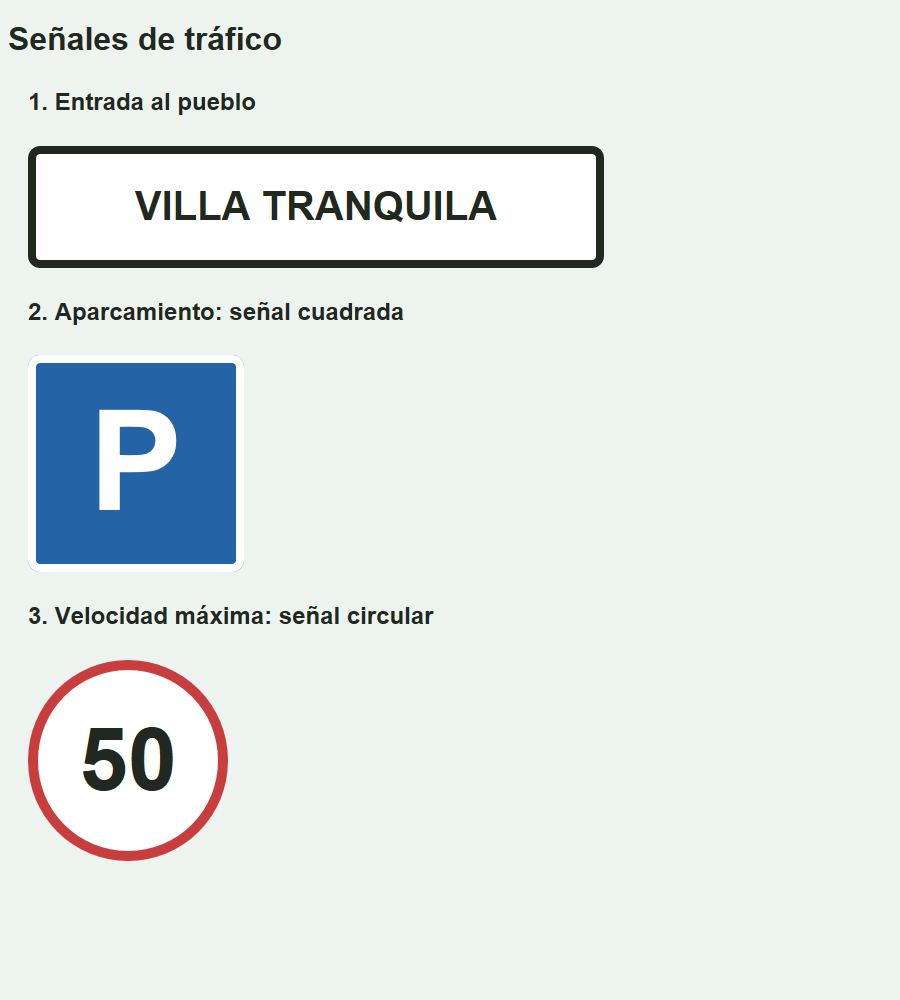

# Tres señales de tráfico

Completa las propiedades CSS dentro de `<style>` en `index.html`. El HTML y las clases ya están preparados. Abre el archivo con Live Server y resuelve las señales en orden.

Las señales se colocan a la izquierda. El texto dentro de cada señal sí está centrado.

## 1. Entrada al pueblo

| Propiedad | Valor |
| --- | --- |
| `width` | 500 px |
| `margin` | 30 px arriba y abajo, 20 px a los lados |
| `padding` | 30 px |
| `border` | 8 px sólido `#202820` |
| `border-radius` | 12 px |
| `background-color` | `#ffffff` |
| `color` | `#202820` |
| `font-size` | 40 px |
| `font-weight` | `bold` |
| `text-align` | `center` |

## 2. Aparcamiento: señal cuadrada

| Propiedad | Valor |
| --- | --- |
| `width` | 200 px |
| `padding` | 20 px arriba y abajo, 0 px a los lados |
| `margin` | 30 px arriba y abajo, 20 px a los lados |
| `border` | 8 px sólido `#ffffff` |
| `border-radius` | 12 px |
| `background-color` | `#2463a6` |
| `color` | `#ffffff` |
| `font-size` | 140 px |
| `font-weight` | `bold` |
| `text-align` | `center` |

El texto y el padding dan a la caja una forma aproximadamente cuadrada.

## 3. Velocidad máxima: señal circular

| Propiedad | Valor |
| --- | --- |
| `width` | 180 px |
| `padding` | 40 px arriba y abajo, 0 px a los lados |
| `margin` | 30 px arriba y abajo, 20 px a los lados |
| `border` | 10 px sólido `#c83d3d` |
| `border-radius` | 100 px |
| `background-color` | `#ffffff` |
| `color` | `#202820` |
| `font-size` | 88 px |
| `font-weight` | `bold` |
| `text-align` | `center` |

El padding deja espacio alrededor del número y el radio redondea la caja. La forma puede variar ligeramente según cómo represente la fuente el navegador.

## Diseño esperado

El resultado es aproximado. Comprueba tu solución con el navegador maximizado.