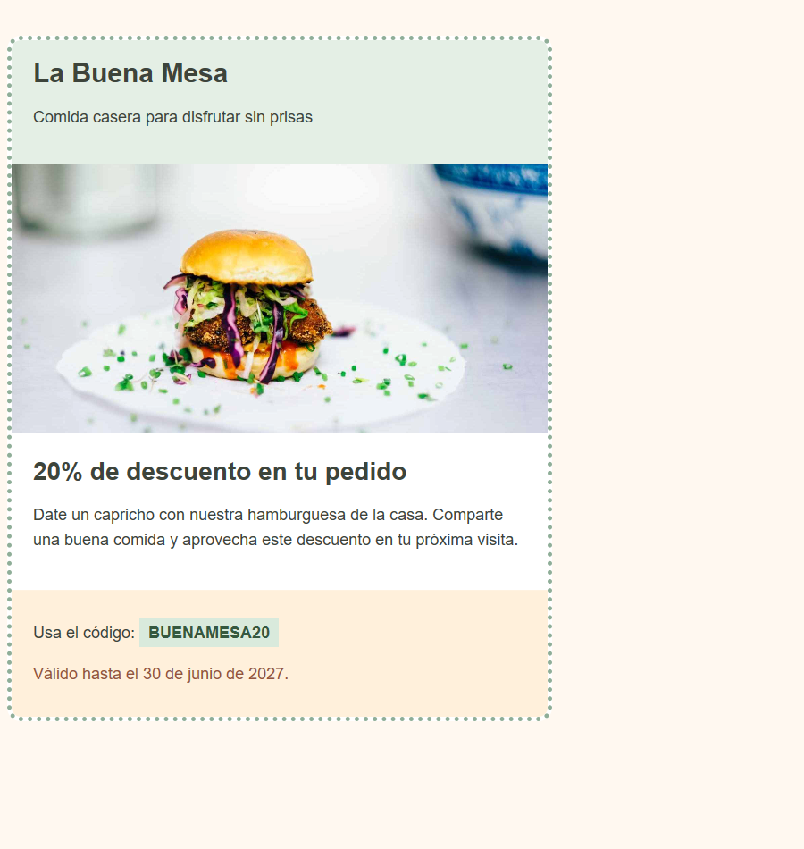

# Un cupón de descuento

Reproduce el cupón de la captura escribiendo todas las reglas CSS dentro de la etiqueta `<style>` de `index.html`. El HTML y la imagen local ya están preparados; tú debes escribir los selectores, las propiedades y sus valores.

1. Abre `index.html` con Live Server.
2. Localiza `<style>` dentro de `<head>`.
3. Escribe tus reglas para dar estilo a la página y a las partes del cupón. Puedes utilizar las clases que ya tiene el HTML.
4. Compara tu resultado con la captura.

## Diseño esperado

## Medidas y colores de referencia

| Parte | Indicaciones |
| --- | --- |
| Página | Arial o sans-serif, 18 px; fondo `#fff8f0`, texto `#3d443b` |
| Cupón | Ancho de 600 px, margen de 40 px arriba y abajo y 0 px a los lados; borde de puntos de 5 px `#8fae98`, radio de 15 px y fondo `#ffffff` |
| Cabecera | Padding de 20 px arriba y abajo y 24 px a los lados; fondo `#e4efe5`, esquinas superiores redondeadas de 10 px |
| Título de la marca | 30 px; margen de 0 px salvo 10 px debajo |
| Imagen | Ancho de 600 px |
| Oferta | Padding de 24 px |
| Título de la oferta | 28 px; margen de 0 px salvo 16 px debajo |
| Párrafos | Conserva el margen natural del navegador; interlineado de 28 px |
| Condiciones | Padding de 16 px arriba y abajo y 24 px a los lados; fondo `#fff0db`, esquinas inferiores redondeadas de 10 px |
| Código | Padding de 6 px arriba y abajo y 10 px a los lados; fondo `#d9eadc`, texto `#35583f` |
| Caducidad | Texto `#94543b` |

La imagen `hamburguesa.jpg` está en la misma carpeta y ya aparece enlazada en el HTML.

El resultado es aproximado. Comprueba tu solución con el navegador maximizado.

Imagen de referencia: [W3Schools, hamburger.jpg](https://www.w3schools.com/w3images/hamburger.jpg).
