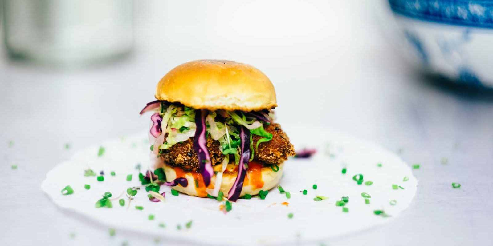

# Un cupón de descuento

El cupón ya tiene el HTML, las clases, la imagen y todos los estilos preparados. Tu tarea es conectar el HTML con su hoja CSS externa.

## Archivos

- `index.html`: contenido del cupón.
- `estilos.css`: estilos completos del cupón.
- `hamburguesa.jpg`: imagen local que ya utiliza la etiqueta ``.
- `disenoEsperado.png`: referencia del resultado con el CSS enlazado.

## Tu tarea

1. Abre `index.html` con Live Server y observa cómo aparece antes de enlazar los estilos.
2. Busca el comentario situado dentro de `<head>` y sustitúyelo por esta etiqueta:

```html
<link rel="stylesheet" href="estilos.css">
```

3. Guarda el archivo y comprueba cómo cambia el cupón.

`rel="stylesheet"` indica que enlazamos una hoja de estilos. `href="estilos.css"` es la ruta del archivo: basta con su nombre porque está en la misma carpeta que el HTML.

La imagen también está en esta carpeta y se enlaza con una ruta relativa:

```html

```

## Diseño esperado


## Observa el modelo de caja

- El cupón tiene 600 px de ancho de contenido y un borde de puntos de 5 px.
- Los bloques interiores tienen padding para separar el texto de los bordes.
- Los márgenes separan títulos y párrafos.
- El código de descuento tiene su propio fondo y padding.

Los colores principales son crema `#fff8f0`, verde suave `#e4efe5` y melocotón `#fff0db`.

El resultado es aproximado. Comprueba tu solución con el navegador maximizado.

Imagen de referencia: [W3Schools, hamburger.jpg](https://www.w3schools.com/w3images/hamburger.jpg).
