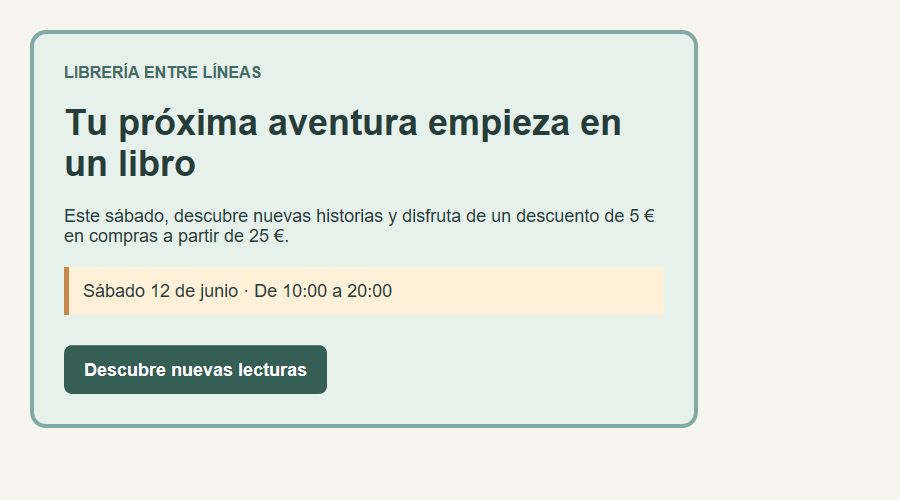

# Un banner de anuncio

❗ **El CSS ya está implementado en `estilos.css`: no tienes que escribirlo. Tu única tarea es enlazarlo desde el HTML.**

## Tu tarea

1. Abre `index.html` con Live Server y observa cómo se ve antes de enlazar el CSS.
2. Dentro de `<head>`, sustituye el comentario por esta etiqueta:

```html
<link rel="stylesheet" href="estilos.css">
```

3. Guarda el archivo y comprueba el resultado.

`rel="stylesheet"` indica que el archivo enlazado es una hoja de estilos. `href="estilos.css"` indica su ruta: solo necesitamos el nombre porque el CSS está en la misma carpeta que el HTML.

## Diseño esperado



## Observa el modelo de caja

- El banner tiene 600 px de contenido, 30 px de padding y un borde de 4 px.
- Su ancho exterior es de 668 px: 600 + 60 + 8.
- Los márgenes separan los textos; el padding separa el contenido de los bordes.
- La fecha tiene fondo y borde propios, y el enlace tiene padding para parecer un botón.

El resultado es aproximado. Comprueba tu solución con el navegador maximizado.
