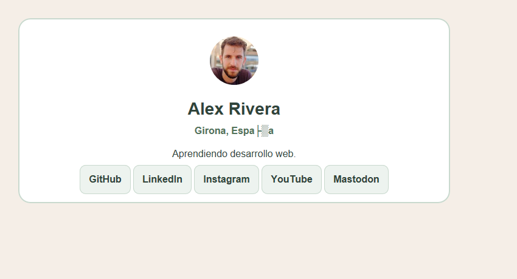
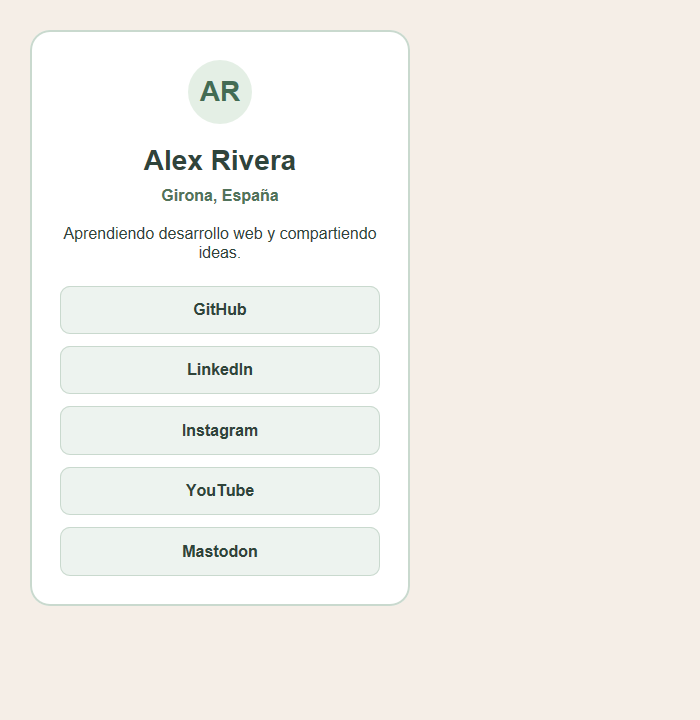

# Una tarjeta con tus redes sociales

Crea una página de presentación con enlaces a las redes sociales de una persona. El HTML ya está preparado; escribe todas las reglas CSS dentro de `<style>` para conseguir una tarjeta similar a la captura.

## Tu tarea

1. Abre `index.html` con Live Server.
2. Enlaza la imagen `avatar.jpg`, incluida en esta carpeta, completando el atributo `src` de la etiqueta ``.
3. Personaliza el nombre, la ubicación y la descripción. Puedes utilizar tus datos públicos o inventar un personaje.
4. Sustituye los destinos de los enlaces por las direcciones de los perfiles elegidos. Los enlaces iniciales llevan a la portada de cada plataforma: todavía no son perfiles personales. Puedes cambiar también las plataformas y sus textos.
5. Elige los nombres de las clases que necesites y añádelas al HTML. Escribe los selectores, propiedades y valores CSS para reproducir la tarjeta. Decide las medidas observando la captura.
6. Comprueba que cada enlace abre el perfil correcto en una pestaña nueva.

## Versión 1. Enlaces uno al lado del otro

Crea primero una tarjeta más ancha, con las redes sociales en una fila. Los enlaces se colocan en línea de forma natural. Ajusta el espacio disponible observando la captura.

## Versión 2. Enlaces uno debajo del otro

Después, adapta la tarjeta para conseguir esta segunda distribución:

**Pista:** aplica `display: block` a los enlaces para que cada uno ocupe una fila. Ajusta los espacios para que los enlaces queden separados.

## Colores de referencia

| Parte | Color |
| --- | --- |
| Fondo de página | `#f5eee7` |
| Texto general | `#30443b` |
| Fondo de tarjeta | `#ffffff` |
| Bordes | `#c9d9ce` |
| Ubicación | `#52735b` |
| Fondo de enlaces | `#edf3ef` |

## Comprueba tu trabajo

- El avatar se muestra correctamente.
- El padding separa el contenido del borde de la tarjeta.
- Hay espacio entre los textos y entre los enlaces.
- Los enlaces conservan etiquetas `<a>` y llevan a las redes elegidas.
- El resultado es aproximado. Tu solución debería verse bien con el navegador maximizado, pero es normal que no se vea bien en una pantalla pequeña.

## Imagen incluida

La imagen `avatar.jpg` está en esta misma carpeta. Procede de [Random User Generator](https://randomuser.me/), que ofrece imágenes de ejemplo para proyectos. El nombre y la descripción del ejercicio son ficticios.
